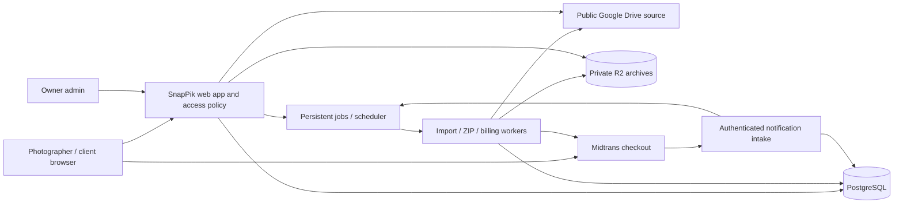

# SnapPik Architecture

**System phase:** TASK-001 foundation, TASK-003 authentication/access policy, TASK-002 local/test provider prototype, TASK-004 project/catalogue, TASK-005 client selection/preview, TASK-006 progress/history/export, TASK-007 finished-photo delivery, TASK-008 complete product ZIP and TASK-009 owner voucher management implementations exist. The configured 384-photo single-ZIP build, independent readback and cleanup passed. A real resource-key fixture remains pending, so TASK-002 and dependent TASK-004–TASK-008 acceptance remain open. Checkout/payment workflows remain planned. [Package state](../index.md). [PRD](../product/PRD.md) owns product behavior and commercial rules.

## Approved boundaries and technology

| Component | Planned choice and purpose |
| --- | --- |
| Application | Laravel with React/TypeScript through Inertia: one session-based web application for public, photographer, client and owner-admin views. |
| UI presentation | ZenGrid-derived shared foundation, semantic light/dark CSS tokens and Motion for React through `motion/react`; installed versions are recorded in the lockfile. Complete product journeys remain planned. |
| Persistence | PostgreSQL for ownership, catalogue revisions, selection state, billing, vouchers, jobs and audit history. |
| Source media | Google Drive API, reading publicly shared photographer folders; no photographer OAuth or hosted photo upload in MVP. |
| Payments | Midtrans Snap checkout, QRIS required at launch; server-verified callbacks and reconciliation. |
| Background work | Laravel persistent database queue, supervised workers and scheduler. Redis/websockets are not required for MVP. |
| Temporary archive storage | Private Cloudflare R2 Standard bucket. Clients receive one ZIP; storage-level multipart upload is an internal transport detail. |
| Email | Framework mail boundary with an operator-configured transactional SMTP service for verification/recovery. No marketing or client-message automation. |
| Hosting | A Linux web host capable of running PHP web processes, persistent workers, scheduler, PostgreSQL and outbound HTTPS. Vendor/domain/sizing are deployment inputs; no service has been purchased. |

The foundation uses Laravel 13 / PHP 8.4+, React 19, Inertia 3, TypeScript, Vite 8, Motion 14 and PostgreSQL, with real dependency lockfiles. It was generated from the official Laravel skeleton with Inertia installed separately; TASK-003 now supplies authentication flows. [README](../../README.md) records actual setup commands; Backlog links verification evidence. Node is needed for frontend build tooling, not a second application backend. The contracts below describe the complete MVP; the bounded TASK-002 implementation is distinguished from planned product behavior below.

### Implemented TASK-002 prototype boundary

`DriveSource`, `ArchiveStorage` and `ArchiveUpload` are provider contracts. `PublicDriveSource` calls only the fixed official Drive v3 API using a configured server API key, resource-key headers, bounded retries and no redirects. It validates metadata, downloadability, media type/length, original MD5 when supplied, and versions before/after streaming. Native status/retry classes are sanitized; provider URLs, bodies and chained SDK exceptions are excluded from diagnostics.

Metadata/listing use `https://www.googleapis.com/drive/v3/`; original media uses **`https://www.googleapis.com/download/drive/v3/`** with `alt=media`. This follows Drive's Discovery `files.get.useMediaDownloadService=true` flag and Google's documented `/download` URL construction, while retaining the same API origin and header-based API key. No arbitrary media URL, redirect following or alternate credential provider is accepted.

Non-success media responses receive the same bounded JSON error classification as metadata requests. A maximum 16 KiB diagnostic prefix may identify Google's HTTP 403 HTML automated-query block as `drive_automated_requests_blocked`; this is a terminal attempt failure, with no automatic retry or HTML/media fallback. A JSON `downloadQuotaExceeded` response has its own terminal `drive_download_quota_exceeded` category; documented JSON rate-limit reasons use the existing bounded retry budget. Raw diagnostic bodies are discarded, never persisted or exposed. This classification distinguishes the native failure observed in the authorized smoke test without changing provider credentials or access boundaries.

`DriveRequestPacer` coordinates request starts across app processes using the configured shared database cache/lock and a SHA-256 credential fingerprint; it stores no API key. `GOOGLE_DRIVE_REQUEST_INTERVAL_MS` defaults to 1000 ms, accepts 100–10000 ms and applies before every metadata/media request and retry. The lock covers the spacing wait; its lifetime exceeds the maximum interval. Cache/lock failure raises sanitized `drive_request_pacing_unavailable`, rather than silently disabling pacing. This operational request scheduling is separate from catalogue/byte entitlements and does not convert an automated-query block into an automatic retry. The existing header-based authentication and fixed official API origin are unchanged.

`drive_proof_runs`, `drive_proof_nodes` and `drive_proof_pages` are isolated prototype tables, not published product catalogues. Runs belong to persisted local test users. Metadata/resource keys and page tokens are encrypted; iterative traversal commits each page and its checkpoint atomically, retains unsupported/shortcut reports, detects identity/page cycles and serializes import attempts with a PostgreSQL advisory lock. Failed imports remain incomplete and can resume from committed checkpoints. Prototype orchestration and the worker refuse production execution; there are no new web endpoints or capability links.

`BuildDriveProofArchive` claims a staged run atomically and passes its scoped ordered manifest to `BuildStreamingZip`. The locked ZipStream-PHP library streams STORE/ZIP64 output to the AWS SDK/R2 multipart adapter. Nonfinal parts use equal, adaptively selected sizes; one temporary part spills to disk above 1 MiB instead of buffering a large object. Multipart Content-MD5, completion length/type checks, whole-attempt abort/delete and a distinct cleanup-required state protect output. Each attempt uses a fresh private key. The smoke verifier independently reads the completed object, extracts each identity and checks count, size, CRC and source MD5. Readiness has a 24-hour expiry; the verifier enforces it. The command can delete proof objects explicitly.

Diagnostic R2 readback first captures the object's length and ETag, then reads contiguous ranges of at most 8 MiB with `If-Match`. Each response must be HTTP 206 with the exact Content-Range, length and original ETag; the complete range is validated before any bytes reach the verifier. Each bounded response finishes through the SDK's normal transport instead of exposing a live whole-object PHP socket stream. Interrupted reads retry the same range up to three times with bounded delay; invalid range responses and permanent 4xx failures stop immediately. The SDK retains its own request retry budget. Each request retains the connection timeout and has a 300-second deadline, without a total-object deadline. Range requests read one private ZIP object; they do not split client output. The existing prototype verifier still uses complete temporary diagnostic disk and removes it after success or failure.

This prototype has no product publication pointer, gallery access/gate policy, client download endpoint, automatic cleanup scheduler, orphan-upload sweeper, leased crash recovery or product deduplication. TASK-004 implements product catalogue pointers and capability gates separately from this proof; TASK-007/TASK-008 now provide product media/archive orchestration. TASK-008 also replaces the shared builder's in-memory central directory with the bounded `BoundedZip` adapter; the prototype-only orchestration still has no product gates or scheduler. Actual Drive import/pagination, all 384 originals in one R2 ZIP, complete independent size/CRC/MD5 readback and cleanup have passed. [TASK-002 evidence](../planning/TASK-002_EVIDENCE.md) records the earlier automated-query failures, canonical-route correction, R2 readback recovery, remaining real resource-key fixture and ZIP-reader compatibility observations.

## Browser appearance and motion

[REQ-021](../product/PRD.md#req-021--light-and-dark-appearance) owns theme behavior. Implement a shared appearance controller for all React layouts and semantic CSS tokens for surfaces, text, borders, focus and interaction states. Define explicit light and dark token sets rather than inverting the rendered page or photo pixels. Resolve a valid stored choice before first paint; otherwise use the browser's system preference. Keep server rendering and client hydration consistent with that resolution.

Store only a validated `light` or `dark` value under the browser-storage key `snappik.appearance`; guard unavailable/blocked storage and use an in-memory fallback. Apply a validated `data-theme` and native `color-scheme` before the application mounts, using a CSP-compatible initialization path. Subscribe to system preference changes only while no explicit choice is present. No database migration, account preference API, entitlement check or project mutation is needed for appearance. A theme switch must preserve mounted form/selection state and ongoing jobs. The [Design System](../design/DESIGN_SYSTEM.md) owns exact tokens and component recipes.

[REQ-022](../product/PRD.md#req-022--consistent-zengrid-presentation-and-accessible-motion) owns interaction behavior. Integrate the planned `motion` package through `motion/react`, with shared timing recipes and `MotionConfig reducedMotion="user"` at the React root. Use `useReducedMotion` for custom stagger, loops and CSS coordination. Keep appearance resolution and animation policy separate so switching theme never recreates the application tree. Simple CSS transitions use the same policy; no premium Motion UI or second animation engine is required.

Preserve Inertia layout identity and normal navigation/focus behavior. `AnimatePresence` may manage transient panels, but exiting nodes must not remain keyboard-active or intercept new actions. Do not wrap the whole application in an exit barrier that delays navigation or remounts stateful forms. Window large catalogues independently of animation; attach motion only to visible mounted items, keep selection state keyed by stable file identity outside tile lifetime, and fall back from shared-layout transitions when an endpoint is absent. Appearance and motion do not add trusted server input or provider permissions.

## System flow

Browser application calls stay on SnapPik's origin. Only Midtrans's hosted payment interface is a required external checkout surface. Gallery pages do not navigate clients to Drive, expose server credentials, or trust arbitrary provider URLs submitted by a browser.

Controllers validate/authorize and invoke transactional Actions. Provider adapters implement explicit Contracts. Job payloads contain record identities and revision/generation references, not credentials, guest capability URLs, caller-selected owner IDs, or unverified money.

## Persistence model

The following entities are proposed schema contracts for implementing the approved behavior. Migrations must enforce their uniqueness/ownership rules; actual file/class names are established during bootstrap.

| Entity | Key fields/relations and invariants |
| --- | --- |
| User | ID, unique normalized email, password hash, role, verification time, suspension state. Public registration cannot assign role. |
| AccountAccess | Unique photographer ID, one trial start/end, current access end, effective paid/trial state projection. Lock this row for trial creation and entitlement grants. |
| PlanVersion | Immutable version of the Pro price/duration; active pointer used for new orders. No paid content count/byte quota columns. |
| Project | Photographer ID, opaque public ID, encrypted share token plus indexed digest, lifecycle state, selection edit epoch/version. Tenant is immutable. |
| GalleryModule | Unique project/type (selection or delivery), publication flag, password hash, gate version, deadline, source folder ID/resource key, published catalogue revision. |
| CatalogueRevision | Module ID, revision state, source root, observed times, complete manifest digest and import diagnostics. Publish pointer changes only after complete import. |
| CatalogueEntry | Revision ID, stable Drive file ID, original filename/relative path, MIME, 64-bit size, Drive version/checksum/modified time, availability. Unique revision/file identity. |
| Choice | Selection module/project, Drive file identity, selected filename/path snapshot, revision reference; unique current selected identity. Missing source must not cascade-delete it. |
| SelectionConfirmation | Immutable project/epoch/version, choice snapshot and confirmed time. Earlier confirmations remain history after reopening. |
| MutationReceipt | Unique scoped operation ID, payload digest, canonical result/version for safe duplicate-request replay. |
| Order | Unique application/provider order identity, photographer, plan/voucher snapshots, integer IDR amounts, provider state, paid time, reconciliation flags, checkout idempotency key. |
| Voucher / VoucherVersion | Unique normalized code root; immutable versioned discount/eligibility terms; active-version pointer; total/per-user accounting across the code root's versions. |
| VoucherReservation / Redemption | Order and voucher root/user relations. One reservation per order; one redemption per paid order. A reservation can be held, consumed or released. |
| EntitlementGrant | Unique paid order ID and immutable duration/access-extension result. No grant from client redirect or manual mark-paid edit. |
| PaymentEvent / Outbox | Durable incoming event or reconciliation observation, authenticity/result digest and processing status; committed events can be retried after crashes. |
| ArchiveJob | Module/revision/manifest digest, gate generation, queued/processing/ready/failed/expired state, lease, progress, private object key, ready/expires time and sanitized error. Deduplicate current work for a manifest. |
| AuditEvent | Admin/system actor, action, target, reason, versions/times and safe diagnostic references. Never contain secrets or full signed URLs. |

Use UTC instants for persistence/comparison, whole integer IDR for money, and 64-bit integers for byte/count metadata. Default human-facing times use Asia/Makassar and display their timezone; provider timestamps with another explicit offset must be parsed accordingly. Do not use floating-point monetary arithmetic, 32-bit byte counters, browser time, array position, or filename alone as authoritative identity.

All tenant-owned records have a direct or enforced relational path to the photographer. A job cannot be redirected into another tenant by changing an input project ID. Financial records and historic selections are retained even when a project is archived. Deletes must not cascade through payment/selection history.

## Access policy

### Implemented TASK-003 account boundary

`AccountController` handles normalized email/password registration/login/logout, signed expiring email verification and broker-based recovery/reset. Public registration validates only name/email/password; role, verification, suspension and access periods are excluded from mass assignment. PostgreSQL enforces case-insensitive email uniqueness and the two allowed roles. Login rotates the session; logout invalidates it. Login and account-mail requests have shared-cache IP/identity throttles. Recovery responses do not disclose account existence or delivery failure. Account links use the configured `APP_URL` origin; login resumes an intended verification URL only on that origin. Framework trusted-host checks use the configured host outside local/unit-test environments.

`VerifyAccount` locks the user before marking verification and creating/locking the unique `account_access` row. The trial starts at verification and lasts exactly 168 hours. Repeated verification, login, password recovery/reset and reactivation cannot change an existing trial. Access timestamps use UTC; equality with `access_ends_at` is expired. Paid fields are a projection for the future verified-payment action, not a public grant API. There is no quota column or manual/free entitlement command. Existing pre-authentication synthetic verified users are not retroactively awarded a trial by migration.

`ResetAccountPassword` serializes token validation/consumption on the user row, revokes database sessions, rotates the remember token and emits the framework reset event after commit. Reset tokens expire after 60 minutes and are hashed in storage; secret arguments are marked sensitive. The session-authentication middleware also rejects an old session password hash on its next request. Auth mutations retain framework CSRF protection. Secret reset fields are excluded from validation flash input.

`AccountMail`/`AccountLink` retain framework signed verification and reset messages. `AUTH_MAILER=array` is the safe local default; only array, SMTP and sendmail transports are accepted. Log and composite failover transports are rejected for account links. Mail exceptions are not logged; verification offers resend, and recovery keeps the same generic response with the broker's one-minute retry window. Real sender configuration and delivery remain release checks.

`AccountPolicy` and `AccountAction` centralize verified photographer read/billing, mutation, checkout, client read/write, download and admin decisions using fresh persisted state. Expiry blocks writes while preserving read/billing/checkout and valid delivery; suspension preserves only account-status/billing access. The dashboard renders the account state without listing suspended project metadata. `TenantResourcePolicy` resolves persisted ownership through `PhotographerOwned`, denies substitution generically and gives admin no photographer-resource bypass. It is registered for the existing proof model. The local/test proof importer, queued build and verifier also check persisted ownership/suspension before provider work; operator cleanup remains possible.

`GalleryGate` composes account decisions with capability/publication/archive/deadline/password-generation/selection-lock checks. TASK-004 resolves these inputs for persisted project/module status and password routes; TASK-005's `SelectionAccess` applies them to selection pages, reads, choices, confirmation and each preview request, including a new request carrying Range. Selection previews return complete inline images rather than partial responses. TASK-007's `DeliveryAccess` applies the same decisions to finished-photo browsing, downloads, HEAD and each Range request. Order schemas/routes remain with subsequent tasks. Test-only proof-resource probes remain separate policy probes.

`snappik:provision-admin` promotes an existing verified, unsuspended dedicated owner account from a server operator console. It accepts no password, invalidates that account's database sessions and writes one audit event on promotion; repeating it is idempotent. `SetAccountSuspension` requires a current admin and transactionally audits photographer suspension/reactivation without changing access periods. No public provisioning route, impersonation or mark-paid path exists. Admin screens/versioned forms remain TASK-012. [TASK-003 evidence](../planning/TASK-003_EVIDENCE.md) records actual verification.

### Implemented TASK-004 project/catalogue boundary

`ManageProject` serializes project creation/restoration/configuration and import publication in user, account-access, project lock order. The trial counts all unarchived projects, including drafts; a paid account has no content quota check. Project state is derived from archive time and the two module publication flags. Stale photographer forms/commands must supply the current project version. Import progress alone does not change configuration version, so polling cannot silently overwrite unsaved settings. Archive preserves records and module flags while incrementing both gate generations; restoration checks entitlement and the trial slot again.

Project capabilities use 32 random bytes, an indexed SHA-256 digest and an encrypted retrievable value. Only the authorized photographer project view receives the share path and source links. Rotation replaces the capability and increments both gate generations. Module passwords are bcrypt hashes with byte/NUL validation; blank edits preserve a hash, and explicit removal clears it. Deadline inputs require an explicit timezone offset and are persisted as UTC instants; the form labels WITA (UTC+08:00). Source changes, password/deadline changes, unpublication, archive/restoration and rotation invalidate prior module sessions. `GalleryController` resolves the digest, rechecks persisted gates on each request and uses module-scoped session generations. Password attempts have shared-cache IP/capability/module throttles. Client responses are private/no-store/no-referrer and excluded from indexing; module status/password pages now link to TASK-005 selection endpoints. No provider URLs are exposed to clients.

`CatalogueRevision` and `CatalogueEntry` stage encrypted source references/provider snapshots and encrypted pagination checkpoints. The `catalogues` queue connection explicitly uses the same `pgsql` database connection as project transactions, inserting a job with only a revision UUID before commit. Rollback removes project/request/job together. `ImportProjectCatalogue` holds a PostgreSQL session advisory lock per revision, allowing redelivery to resume committed pages while excluding concurrent workers. It rechecks persisted owner entitlement, archive state and requested revision before provider work, on every page and under domain locks before publication. A superseded revision cannot replace the current pointer. The worker has no catalogue-size timeout; provider transport retry/deadline limits still apply. Operational/provider failures are stored as safe codes for explicit refresh; no raw exception or source URL is recorded in revision diagnostics.

Traversal pages every descendant folder, detects repeated identities/page cycles, reports shortcuts without traversing them and excludes unsupported files. The complete manifest digest is computed in bounded database chunks; original bytes are never downloaded by metadata imports. Root/folder/photo intersections with the other module's accepted revision and configured root reject overlapping source trees. Completion, digest and module catalogue pointer change commit together; module publication itself remains a photographer action. Refresh of an already published module replaces its pointer after success. Failure retains the old pointer and exposes stale status. Choice identities/name/path/revision snapshots are retained independently; unavailable choices are derived by a scoped anti-join against the latest accepted selection revision. Configuration rejects allowance reduction below retained choices and source replacement while selection is locked. TASK-005 adds nullable parent file identities for new imports so duplicate folder names remain separate. Existing revisions retain all-photo access; their UI requests a photographer refresh to enable identity-based folder navigation, without guessing ambiguous historical parents.

Photographer lists and complete excluded-file/missing-choice diagnostics paginate at 20 rows; the project page includes bounded samples and aggregate counts. These are response windows, not content limits. The local/synthetic verification and real-provider prerequisite are recorded in [TASK-004 evidence](../planning/TASK-004_EVIDENCE.md). Real resource-key verification remains pending in TASK-002; deployment must still redact capability paths from reverse-proxy/access/analytics logs and verify backups, workers and media boundaries before launch.

### Complete MVP policy contract

Centralize the product permission matrix in one service/policy layer with distinct decisions:

1. Photographer read/billing access.
2. Photographer mutation entitlement.
3. Client selection read versus write/confirm.
4. Delivery read/download/job creation.
5. Platform-admin operations.

Resolve current account suspension, account access end, project archive state, module publication/deadline, module gate version/password session, and action-specific lock state. Paid expiry disables selection/configuration writes, but does not disable valid delivery reads or ZIP creation. A published gallery with a module deadline is still closed at that deadline. An admin suspension denies client galleries regardless of either clock.

Use a high-entropy project share capability separate from a photographer's internal project identifier. Store its lookup digest and only an encrypted form where the photographer must retrieve/share the link again. Password sessions are scoped to project/module and bound to a gate version. Password changes, token rotation, unpublication and archive changes invalidate new requests. Use secure HttpOnly/SameSite cookies, server-side session invalidation, CSRF protection and login/password-attempt throttles.

Private media routes re-evaluate access on every new request, including Range requests. A response already authorized may finish after a subsequent expiry; no system can recall bytes already delivered. Do not publish R2 buckets, place reusable public object URLs in page state, or rely on long-lived presigned URLs that bypass changed gates. Implement authenticated bounded-memory proxy/range streaming, or an equivalent internal reverse-proxy arrangement with the same per-request gate. Provider URL signing remains server-side.

## Drive integration and catalogue publication

### Public-source contract

- Parse supported Drive folder URLs into IDs and optional resource keys. Reject arbitrary fetch destinations, nonfolder resources and unsupported protocols. Use a restricted server API key for public-resource requests; validate this exact integration in the early provider spike. If an authorized official access path needs a different credential, stop and review the boundary instead of scraping Drive HTML or requesting broad photographer OAuth silently.
- Use API pagination and incremental traversal for descendants. Avoid recursion/array accumulation proportional to the entire catalogue. Detect cycles and report shortcuts; do not follow them outside the configured tree. Unsupported files are reported separately from supported JPEG/PNG catalogue entries.
- Persist page/traversal checkpoints and stage entries in a new revision. Retry temporary quota/5xx errors with bounded exponential backoff and jitter; a failed inaccessible descendant prevents a false complete result. Manual refresh replaces the published pointer only after success.
- Keep selection/delivery roots separate and reject overlapping photo identities before publishing delivery. One source root can contain nested folders, but the two product modules must not unintentionally publish the same source tree.
- Reference original file IDs as identities, retaining original name/path snapshots for confirmations and exports. Rename/reorder alone cannot attach a choice to another file. A missing draft choice remains visible with a warning and must be restored or explicitly deselected before a new confirmation; prior confirmed history remains readable.
- A caller-supplied Drive file ID is never sufficient for access. Resolve it through the authorized published catalogue first.

Drive's short-lived thumbnail links should be obtained/refreshed through the adapter and served through a proxy. They are not permanent database identifiers or direct browser URLs; Google's [file resource documentation](https://developers.google.com/workspace/drive/api/reference/rest/v3/files) explicitly describes their short lifetime and CORS limitation. Some shared links need [resource-key headers](https://developers.google.com/workspace/drive/api/guides/resource-keys); retain and propagate them without logging link capabilities.

For individual originals and ZIP inputs, verify download availability and expected content metadata. Use official [Drive download interfaces](https://developers.google.com/workspace/drive/api/guides/manage-downloads). Reject unexpected HTML/login responses, inappropriate content types, changed versions and truncated streams. Fetch only allowlisted provider endpoints; validate redirect hosts instead of becoming a general SSRF proxy.

### Source of truth and storage

Drive owns the original bytes and permissions. PostgreSQL owns project configuration, published snapshots, choices and financial state. A metadata import does not continuously watch Drive. Refresh is explicit; a stale gallery cannot claim a live source synchronization guarantee. The app does not persist a permanent library of originals or upload customer photos to the owner's Drive in MVP. R2 contains transient archive bytes, not purchased photo-upload capacity.

### Implemented TASK-007 individual delivery

`DeliveryController` resolves every entry and folder through the currently authorized delivery revision; selection entries, retired revisions and other projects cannot be substituted. Existing TASK-004 photographer publication/configuration is reused. `DeliveryAccess` composes persisted capability/module/password-generation/archive/deadline and account checks using `GalleryGate`. Ordinary account expiry permits valid delivery; suspension denies it. The UI paginates 36 photos and 20 folders, retaining a bounded gallery window, with same-origin thumbnail/original enlargement and explicit preview retry.

`DeliveryMedia` translates a scoped snapshot through provider Contracts, streaming an inline original or native browser attachment with sanitized Unicode filenames, an ASCII fallback and safe image extensions. Safe JPEG/PNG names keep their extension/case; separators, controls, bidi-format characters and reserved device names are sanitized. No originals cache, application content quota or provider redirect is introduced. Failures discovered before headers return a safe 502 text response without attachment/image headers; the download opens a tab so a failed request remains visible. The browser owns transfer-completion reporting; the UI does not announce success on click.

Single byte ranges support closed, open-ended and suffix forms. Unsatisfiable supported ranges return 416 with `Content-Range: bytes */size`; malformed, unsupported and multipart ranges are ignored in favor of the complete response. A matching strong `If-Range` validator retains partial delivery; stale/weak/date validators return the complete representation. HEAD rechecks provider metadata/download permission without reading original bytes. Range/HEAD/conditional requests always pass application gates first; no conditional 304 shortcut bypasses authorization. The ETag represents the published original identity/version/size/checksum/timestamp/type; no provider URLs or keys are exposed.

`DriveRangeSource` is implemented by the existing official API-key adapter on the canonical media endpoint. It checks fresh identity/download permission/version/type/size/checksum/timestamp, requests identity encoding and validates exact 206 boundaries/total/length/type before exposing a partial stream. `VerifiedOriginalStream` validates the received partial length and rechecks metadata/permission at EOF; full originals additionally verify MD5. A partial range cannot independently establish the whole-file checksum. Reads stay in 64 KiB chunks, with a bounded prefix check before response headers and one pending chunk withheld until the next read/EOF verification succeeds. A late transfer/integrity failure closes the source without appending an HTML document, leaving the advertised Content-Length incomplete. Already authorized responses may finish after application gates change; every new request resolves them again. Deployment proxy buffering/compression and real-provider Range behavior remain explicit integration checks in [TASK-007 evidence](../planning/TASK-007_EVIDENCE.md).

## Selection transactions

Implemented TASK-005 contracts use `/g/{capability}/selection` with `/data`, `/choices`, `/confirm` and `/preview/{entry}` subroutes, plus the authenticated `/projects/{project}/selection/reopen`. Per-photo mutations include a UUID operation ID, expected selection version/epoch and published revision UUID. Review reads the canonical set; confirmation includes that reviewed version/revision; reopening includes the photographer's expected selection version/epoch. These contracts must survive UI refactoring.

For every mutation, lock the selection/project aggregate in a database transaction, then recheck current entitlement/gates, edit epoch and confirmation state. Check the mutation receipt before applying the change. Add/remove one identity, enforce the allowance against the canonical count, increment the version and store the receipt/result atomically. Reusing an operation ID with another payload is an error. Return a conflict response with current state when the expected version is stale; the client must rebase visibly, not overwrite the set.

Confirmation locks that same aggregate, checks a nonempty eligible canonical set and reviewed version, then creates one immutable confirmation snapshot and marks the current state confirmed. A repeated identical confirmation is idempotent. A simultaneous edit either commits before confirmation and invalidates the review, or loses to confirmation and is denied. Reopening is a photographer-only transaction that preserves the current choices and old confirmation, increments epoch/version, and sets current selection back to open/selecting. New client requests cannot reuse a pre-reopen epoch.

Use HTTP success only after database commit. The UI can optimistically indicate an in-flight change but cannot display it as saved before acknowledgement. A network disconnect preserves already committed choices, offers refresh/retry for uncertain operations, and never queues silent future writes after expiry/confirmation.

`ManageSelection` follows user → account-access → project locking, matching configuration/import publication. It revalidates the capability digest and current module/password gates after waiting. Receipts persist a payload digest and compact result alongside the mutation/version commit; identical retries return their original result plus fresh canonical state, including after reopening, without executing an old operation again. Payload reuse returns 409. Stale versions/epochs/revisions return 409 with canonical state; allowance/missing-choice/empty-confirmation failures return 422; expired account or current selection lock blocks new writes. Deadline/archive/password/suspension/capability denial remains generic 404. Repeated identical reviewed confirmations also reuse the current snapshot with a new operation ID. Reopening preserves choices and immutable history under a new epoch/version; deadlines still apply.

Confirmations and their filename/path/revision choice rows are inserted in one transaction with `INSERT … SELECT`, rather than loading all choices into PHP. Gallery/review reads hold a shared project lock for a consistent state/page. Responses and mounted tiles are bounded to 36 photos and 20 folder records; folder subtree queries follow stable parent identities in PostgreSQL. The photographer configuration page exposes the count and first 20 draft/locked choices; TASK-006 adds the complete paginated results/history and export boundary below.

`ProjectProgress` serves the TASK-006 dashboard/project overview (20 projects per page), current or immutable-confirmation results (20 choices per page) and confirmation history (10 per page). It scopes persisted ownership and fresh account Read permission under shared user → account-access → project locks, matching the existing writer lock order. Expiry permits results/export reads, while suspension denies project data; the suspended dashboard returns account status without project metadata. Current status comes from the current lock/count, with separate expiry/archive/publication/deadline context; an earlier snapshot never makes a reopened epoch currently confirmed. Availability means membership in the current published catalogue, not a live Drive availability probe.

`projects.selection_updated_at` is committed with each new acknowledged choice/confirmation/reopen operation, separately from configuration/import timestamps. Receipt replay does not change it. The additive migration backfills the newest known choice/confirmation time; old reopen or removed-choice times were not recorded and cannot be reconstructed. Human-facing times use WITA. Results/overview poll every 15 seconds while visible, offer explicit refresh, and retain the last acknowledged response with a stale warning after transport failure. Permission denial hides results/actions. Independent failed-import warnings identify retained catalogue metadata.

The authenticated `/projects/{project}/results`, `/results/data` and `/results/export` contracts accept only project-scoped confirmation UUIDs. Export is the complete saved set, independent of UI pagination; copy never confirms or changes it. Unique names retain full original filenames; duplicate names use stored relative paths, with stable file IDs appended when paths also repeat. Backslashes and CR/LF are escaped as `\\`, `\r`, `\n` to preserve one record per line. Window counts span the complete set before 500-record chunk reads. A temporary stream spills to OS temporary storage after 1 MiB; the authorized read transaction finishes preparing the complete text before HTTP output. Temporary write failure fails the request; the stream is closed after output. The UI supplies the displayed draft version/revision so changed results produce 409 and require refresh. Immutable snapshots remain independently exportable. Full text is loaded into the browser only on explicit preparation and remains in a labeled selectable textarea when clipboard access fails. No provider/media request, public export URL, external message or content quota is introduced.

`DrivePreviewSource` obtains fresh `thumbnailLink` metadata from the official adapter and proxies only HTTPS `lh3`–`lh6.googleusercontent.com` image responses, without redirect following or forwarding API/resource credentials. Unsupported hosts/responses show retryable preview failure. No short-lived URL is persisted or sent to the browser. Enlarged previews use the existing verified original stream; both paths recheck module gates before provider work, stream in 64-KiB reads, close streams and remain private/no-store. The UI retains uncertain operation IDs only in mounted memory for explicit retry; it has no offline queue. [TASK-005 evidence](../planning/TASK-005_EVIDENCE.md) distinguishes synthetic preview verification from real-provider/release gates.

## Checkout, vouchers and payment processing

### Implemented TASK-009 voucher administration

`ManageVoucher` locks the persisted admin user and then the voucher root, rechecks owner access and the submitted version number, appends immutable terms, advances the current pointer and inserts an audit event atomically. Codes are trimmed/uppercased at creation and cannot be renamed, deleted or reused. PostgreSQL enforces unique normalized roots, version/root identities, valid term ranges, immutable version/redemption history and reservation identity uniqueness. Each edit, deactivation or reactivation creates a version; it does not mutate an earlier order's terms. WITA inputs are converted to UTC before persistence to preserve their exact instants.

`VoucherUsage` counts held reservations and successful redemption records across the root's entire history. An edit rejects a total limit below occupied capacity, or a per-user limit below the largest occupied count of any account. Released reservations do not occupy capacity. All future reservation/payment writers must take the same root lock, following the account/order/root lock order below. Owner reports paginate versions, reservations, redemptions and audited reasons. Photographers have no administration/report access. Form validation returns to an explicit form route because the no-referrer policy and Inertia navigation cannot rely on Laravel's previous-URL session value.

`VoucherQuote` is an immutable integer-IDR result containing voucher/version identity, base, discount and payable amounts. It checks the chosen version's enabled state and start-inclusive/end-exclusive interval, uses overflow-safe integer percentage arithmetic, and rejects nonpositive/below-configured-minimum totals. It evaluates terms only: it does not accept an order, reserve usage or verify payment. Merchant/channel configuration, order snapshots, checkout and payment Actions remain TASK-010/TASK-011. Positive form integers are bounded by the JavaScript safe-integer representation; omitting use limits represents unlimited use.

The reservation/redemption schema exists for usage reporting, with stable unique order UUIDs and one immutable redemption per reservation. TASK-010 must add the order foreign key when the order table exists; TASK-010/TASK-011 must own atomic ledger writes. There is no production ledger-writing or manual grant endpoint in TASK-009. Synthetic tests populate those rows directly only in the guarded test database. An existing quoted pending order remains governed by its original snapshot; deactivation/date changes must not cause settlement to recompute eligibility using the current version.

### Money and configuration

PRD is authoritative for price, duration and eligibility. Compute percentage discounts with integer arithmetic: floor(base IDR multiplied by percentage divided by 100). Fixed discounts subtract whole IDR. Reject nonpositive payable amounts and channel-minimum violations instead of clipping the discount. Preserve base, discount, payable, currency, voucher root/version and purchased duration in the order.

Midtrans currently documents QRIS minimum IDR 1 in its [payment amount limits](https://docs.midtrans.com/docs/berapa-jumlah-transaksi-minimal-dan-maksimal-yang-dapat-diterima-oleh-midtrans). Treat the enabled channel's merchant-confirmed limit as deployment configuration and validate it in sandbox/merchant setup; do not apply QRIS's minimum to future channels automatically. The MVP does not add a zero-price entitlement shortcut or charge customer fees not shown in its quote.

### Reservation and provider-order creation

1. Authenticate a verified, unsuspended photographer and receive a checkout idempotency key. Ignore client-supplied final price/duration/owner.
2. In a transaction, lock AccountAccess first and recheck the photographer's verified/unsuspended state, then lock the active plan/version pointer and voucher root where applicable. Recheck dates, enabled state, total/per-user used plus held counts, and amount validity. Voucher accounting spans all versions of the same code. Account suspension and entitlement-changing actions use the same account lock, so a stale page cannot begin checkout after suspension has committed.
3. Insert the immutable order and a held reservation atomically. Enforce unique photographer/idempotency key. A replay with different inputs is rejected; a replay with the same inputs returns the original order.
4. Commit before contacting Midtrans. Use the application's stable order ID in the provider request. Record the Snap token/expiry safely; never expose the Server Key.
5. Provider timeout is an unknown creation state. Reconcile using the same order identity before retrying creation; never create a second order merely to escape a timeout.

One active reservation counts toward both applicable limits. Admin edits create versions; deactivation blocks new orders but does not cancel existing quoted pending orders. A limit cannot be reduced below current held plus successful usage. Code roots cannot be deleted/reused to evade historical accounting. Reservations convert to redemption only upon authoritative settlement.

Leaving the checkout screen, a client-side timer or a failed status request cannot release a reservation. Release only after provider-confirmed terminal nonpayment or confirmation that order creation definitively failed. If cancellation is requested, treat it as pending until provider cancellation is confirmed. This prevents paying a supposedly abandoned order after its last voucher slot was resold.

### Callback intake and reconciliation

- Intake validates shape/authenticity using Midtrans's prescribed signature contract, validates the configured merchant/order mapping, and durably stores a safe event before acknowledging receipt. A persistence failure returns retryable failure. Unknown/invalid signed events cannot mutate entitlements.
- The processor retrieves authoritative provider status through the same adapter used by reconciliation. Compare IDR currency and exact integer gross amount to the immutable order. A signed callback alone is not sufficient when identities, amounts or state disagree.
- QRIS settlement is the success condition for the launch channel. Pending/deny/expire or browser finish callbacks do not grant. Other unconfigured channel statuses do not inherit a permissive success mapping.
- In one transaction lock AccountAccess, Order and relevant voucher accounting rows using a consistent global lock order. Recheck the unique grant, apply the extension based on verified paid time and current access end, insert the unique grant/redemption, consume the reservation, and mark the order applied. An exception rolls back all local financial effects.
- Unique order/grant/redemption constraints and retries make duplicate/out-of-order events safe. Concurrent different settlements serialize on AccountAccess so neither extension overwrites the other.
- Periodically reconcile pending/unknown/stuck events and expose a safe admin recheck. Once paid, a stale pending or failed observation cannot regress the order or remove days.

Follow [Midtrans notification verification and retry guidance](https://docs.midtrans.com/docs/https-notification-webhooks); use [Snap](https://docs.midtrans.com/docs/snap) and the [QRIS state reference](https://docs.midtrans.com/reference/qris). These are planned integrations, not connected merchant accounts.

### Delayed and exceptional financial events

A delayed webhook while the provider still considers an order paid honors that order's original contract and grants once; never discard it based only on a local expiry timer. If the provider contradicts a previously verified terminal result after a reservation was released, reconcile explicitly, honor an authoritative paid order once, and flag any resulting voucher-accounting exception for admin review. Do not double-charge or silently deny an already paid contract to hide an exception.

Unknown states, amount mismatches, refunds/reversals/disputes are review records and alerts. No automated refund execution, manual mark-paid operation, or automatic entitlement clawback is included in MVP. Keep the original grant/redemption ledger immutable; an operator can investigate in Midtrans and use the documented account suspension control if necessary. A future refund/credit workflow needs its own approved policy.

## ZIP generation and delivery

### Manifest and job identity

An authorized delivery request creates a manifest of the complete published revision, ordered by stable relative path and file identity. It records each file's ID, safe archive path, expected byte length, provider version/checksum and the manifest digest. The aggregate can be paged from PostgreSQL instead of materialized in RAM. Duplicate relative names receive deterministic file-ID suffixes, preserving every input; sanitize traversal sequences, separators, control characters and absolute paths.

Deduplicate active/ready work by module, revision and manifest digest. A requester can reattach to the same job after reload. Gate-version changes invalidate an old job for serving. A new source revision never reuses the previous revision's ZIP. Requests remain subject to delivery gates even though ordinary subscription expiry permits them.

### Streaming worker

Use a streaming ZIP64-capable library and incremental S3-compatible multipart output to private R2. JPEG/PNG can be stored without recompression. Neither the whole source set nor the whole archive may be held in process memory or required as one large web request. A single storage object's multipart transport is not a multi-part ZIP: the user receives exactly one `.zip`.

For each input, validate the current source identity/version/downloadability, stream with length/CRC tracking, and count it complete only when its full entry succeeds. Check all manifest entries, completed counts/bytes and output finalization before setting ready. On an input failure or source change, fail the complete attempt and abort/delete partial output. Publish no “successful” partial archive. Retrying after a stream interruption can restart the attempt; never append a second partial entry to hide corruption.

The library's [ZIP64 and output-stream options](https://maennchen.dev/ZipStream-PHP/guide/Options.html) support large-archive generation. The exact streaming storage adapter must be proven in the first technical spike, not treated as an already working integration.

### Implemented TASK-008 archive boundary

The capability-scoped `/g/{capability}/delivery/archive` GET/POST endpoints resolve fresh delivery gates inside a project lock. POST snapshots every photo in the complete published revision, independently of UI folder/page inputs. `archive_entries` retains encrypted provider snapshots, safe deterministic paths, identities and 64-bit expected lengths; a SHA-256 digest covers the ordered manifest. Unique module/revision/gate generation plus serialized creation deduplicates queued, processing and unexpired ready output. A new revision or generation never reuses older output. Failed/expired requests reuse the immutable job manifest and enqueue a fresh attempt. A 20-request/minute creation throttle protects work submission without setting a content quota.

The `archives` queue connection inserts its UUID-only job into the same PostgreSQL transaction as the manifest. `BuildDeliveryArchive` takes a session advisory lock per job, persists an attempt and unique `archives/{job}/{attempt}.zip` key before provider work, then renews a 15-minute lease at entry boundaries and at most every ten seconds during output. It checks persisted publication/revision/generation/archive/deadline/account eligibility before each input, periodically during output and again under the project lock before publishing ready. Browser password-session expiry does not cancel a build. Ordinary account expiry permits delivery/ZIP creation; suspension does not. Duplicate queue deliveries cannot overlap a live worker. Provider transport retries remain bounded; source/permission failures require explicit recreation rather than automatic infinite retries.

`BuildStreamingZip` uses `BoundedZip`, an isolated adapter to the locked ZipStream entry encoder and directory/footer generators. It uses STORE/ZIP64, validates exact input lengths plus surplus/EOF verification and spills directory records to a temporary stream after 1 MiB. PHP wrapper read-ahead is limited to the expected entry size so it cannot hide surplus bytes from the source verifier. This uses dependency-internal encoder APIs: dependency updates must rerun byte/count/CRC/ZIP64 tests. No vendor files are modified. Neither full sources/output nor all central-directory records are retained in RAM. A native object/path/part capacity failure remains explicit; no paid-content quota or split archive is introduced.

`ArchiveRecovery` runs through `snappik:archives-maintain` every minute. It fails expired processing leases only after acquiring the session lock, making killed workers visibly retryable while protecting live slow workers. Every attempt remains tracked until exact-key multipart enumeration/abort and object deletion succeed. Cleanup paginates upload listings, ignores any other key, retries on later runs and never scans a backup prefix. Unexpired eligible ready output is protected; retired generations/revisions and expired output are removed. This design requires a continuously supervised worker and scheduler; queue redelivery is not a replacement for maintenance.

Protected ZIP downloads resolve the current authorized revision/generation and readiness/expiry on every GET, HEAD and Range request. `expires_at` equality denies access even when physical cleanup fails. Content-Disposition uses a fixed safe ZIP name; full/partial transfers use bounded ETag-pinned private R2 reads with expected total-size checks. Strong If-Range, suffix/open ranges, 416 and complete-response fallbacks follow the individual-download contract. Initial storage failures produce text without attachment headers; late failures leave an incomplete advertised transfer. No public object URL is returned. An already authorized response can finish after gate changes; a new request must pass again.

An initial private-object read failure marks the still-current ready attempt failed, allowing explicit recreation; a stale download cannot overwrite a newer attempt. The client polls persisted status every five seconds while visible and on reopening, shows measured completed-file progress, and explicitly offers failed/expired recreation. Transport failure marks the last status stale and hides the download link until fresh authorization succeeds. Appearance switching preserves the mounted job state; browser downloads stream outside JavaScript memory. [TASK-008 evidence](../planning/TASK-008_EVIDENCE.md) records synthetic application/SDK/process/browser and large-stream verification; real resource-key and deployment privacy/provider checks remain open.

### Native limits and cost controls

There is no application paid-plan photo/file/project size threshold. Nevertheless [R2's current limits](https://developers.cloudflare.com/r2/platform/limits/) include a maximum single multipart object of approximately 4.995 TiB and a bounded number of upload parts. Drive also has [request/transfer quotas](https://developers.google.com/workspace/drive/api/guides/limits). These limits are service constraints, not SnapPik package quotas. An unsupported source/export must report a precise provider-capacity failure and retain metadata/choices; do not silently truncate, split, or redirect it. A change of provider to expand this capacity would require architectural review.

Use adaptive multipart sizing compatible with provider limits, bounded worker concurrency, deduplication, per-request abuse protection and operational cost alerts. Queueing and backpressure can delay jobs; they cannot label a truncated job complete. No constant `maxProjectBytes`, `maxPhotoBytes` or `maxPaidPhotos` may be introduced to simplify resource management.

### Expiry, download and cleanup

Set `ready_at` only after completed-object validation and `expires_at = ready_at + 24 hours`. The application denies expired archive access regardless of whether physical cleanup has finished. A scheduled sweeper deletes expired objects, aborts orphaned multipart uploads and retries cleanup failures. An R2 lifecycle rule is a backstop; [lifecycle deletion can lag](https://developers.cloudflare.com/r2/buckets/object-lifecycles/) and must not be the access-control clock. The archive's timer is independent of metadata retention and module deadlines.

The client requests a protected SnapPik download endpoint. Support range transfer with per-request authorization and safe Content-Disposition. Do not expose permanent object URLs or secrets. Expired/suspended/unpublished module gates block new download requests even for a previously ready ZIP. A password session may need to be reacquired after a long build; its expiry alone does not corrupt the job. Building can continue only while its persisted module/gate generation remains eligible. Abandoned browser tabs do not cancel work.

## Jobs, observability and recovery

Persist job states and leased attempts. Claim jobs atomically; prevent overlapping imports per module and identical ZIP builds. Dispatch work through a committed outbox or after-commit queue mechanism. Configure bounded retry/backoff for provider timeouts/429/5xx; permission errors, source changes, invalid signatures and validation errors require an explicit remedy rather than infinite retries. A dead worker's expired lease can retry or fail visibly. Do not automatically publish half-built data.

Log correlation IDs, operation/attempt IDs, error class and safe provider status, excluding passwords, full capability URLs, signing tokens, API secrets and photo content. Monitor queue age, failed imports/ZIPs, payment reconciliation age, archive cleanup backlog and resource usage. Admin diagnostics link to safe metadata; raw payload access is restricted and minimized.

Create encrypted off-host PostgreSQL backups on a scheduled basis and verify restoration in an isolated environment before launch. Operational starting design: daily backups with seven retained daily versions, adjustable by the operator after reviewing recovery needs. If R2 is used for backup storage, use a separate private bucket and independent encryption/retention; the 24-hour archive cleanup must never target backups. Backups must cover financial/selection consistency; source Drive originals remain the photographer's responsibility. Do not claim the temporary ZIP cache is a backup service.

## Verification strategy

TASK-001 establishes the foundation feature/component/browser checks and actual commands in README. TASK-002 adds synthetic provider contracts, PostgreSQL staging tests and an opt-in measured ZIP64 test, also configured as a separate CI step. The product-domain and actual provider checks below remain planned unless explicitly evidenced in Backlog. Backlog owns execution sequencing and evidence.

- Unit tests: integer discount/rounding and minimums, UTC interval comparisons, allowance decisions, path sanitization and provider state mapping.
- Database feature tests with real PostgreSQL transactions: tenant isolation, last trial slot, last choice slot, edit-versus-confirm, duplicate callback, simultaneous extensions, last voucher reservation and safe release. Do not replace these races solely with mocked repository tests.
- Adapter contracts: paginated public Drive reads, resource keys, HTML/truncated input rejection, Midtrans authenticity/status/amount handling, multipart output and cleanup failures.
- Browser flows: photographer signup/trial, source import/publish, client choose/reload/review/confirm, photographer reopen/export, distinct delivery gates, individual download, ZIP progress/reload/download, voucher checkout, expired read-only views and owner-admin operations.
- Archive integrity: compare expected file identities/counts/bytes and CRC-readable extraction; include duplicate filenames, a failing second file and a synthetic stream above 4 GiB. Measure worker memory against the documented implementation budget; do not use huge RAM as a substitute for streaming.
- Sandbox and launch smoke tests: authoritative payment settlement/retry/reconciliation, real public folder permission behavior, private R2/range delivery, running workers/scheduler, SMTP, backup restore, HTTPS and redacted monitoring.

## Material implementation risks

| Risk | Required control / early proof |
| --- | --- |
| Public Drive access or resource keys behave differently from the reference | Official-adapter spike with an authorized public folder; no HTML-scraping fallback or silent OAuth scope expansion. |
| An archive exists but omits a failed input | Manifest accounting and fail-complete semantics; inspect actual ZIP entries in tests. |
| Unbounded content creates large jobs and operating cost | Streaming, pagination, queue backpressure, deduplication and metering; keep package entitlements unlimited. |
| One ZIP exceeds an external provider's structural capacity | Report native limit clearly; architectural capacity expansion requires review. |
| Voucher/renewal races or provider callbacks repeat | Locks, unique grants/redemptions, immutable snapshots and reconciliation. |
| Public source is mistaken for private photo storage | Explain the source-sharing limitation in photographer setup; password protects SnapPik routes, not the public Drive itself. |
| Production accounts/merchant/channel/email/domain are not configured | Release blocker in Backlog; do not claim these services are ready from a documentation check. |
