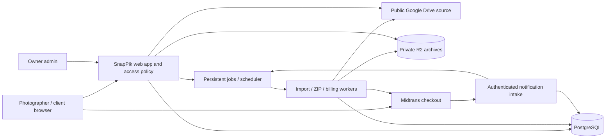

# SnapPik Architecture

**System phase:** TASK-001 foundation and TASK-002 local/test provider prototype implemented; the configured 384-photo single-ZIP build, independent readback and cleanup passed. A real resource-key fixture remains pending, so TASK-002 is not complete. Product workflows remain planned. [Package state](../index.md). [PRD](../product/PRD.md) owns product behavior and commercial rules.

## Approved boundaries and technology

| Component | Planned choice and purpose |
| --- | --- |
| Application | Laravel with React/TypeScript through Inertia: one session-based web application for public, photographer, client and owner-admin views. |
| UI presentation | ZenGrid-derived shared foundation, semantic light/dark CSS tokens and Motion for React through `motion/react`; installed versions are recorded in the lockfile. Complete product journeys remain planned. |
| Persistence | PostgreSQL for ownership, catalogue revisions, selection state, billing, vouchers, jobs and audit history. |
| Source media | Google Drive API, reading publicly shared photographer folders; no photographer OAuth or hosted photo upload in MVP. |
| Payments | Midtrans Snap checkout, QRIS required at launch; server-verified callbacks and reconciliation. |
| Background work | Laravel persistent database queue, supervised workers and scheduler. Redis/websockets are not required for MVP. |
| Temporary archive storage | Private Cloudflare R2 Standard bucket. Clients receive one ZIP; storage-level multipart upload is an internal transport detail. |
| Email | Framework mail boundary with an operator-configured transactional SMTP service for verification/recovery. No marketing or client-message automation. |
| Hosting | A Linux web host capable of running PHP web processes, persistent workers, scheduler, PostgreSQL and outbound HTTPS. Vendor/domain/sizing are deployment inputs; no service has been purchased. |

The foundation uses Laravel 13 / PHP 8.4+, React 19, Inertia 3, TypeScript, Vite 8, Motion 14 and PostgreSQL, with real dependency lockfiles. It was generated from the official Laravel skeleton with Inertia installed separately, leaving authentication flows to TASK-003. [README](../../README.md) records actual setup commands; Backlog links verification evidence. Node is needed for frontend build tooling, not a second application backend. The contracts below describe the complete MVP; the bounded TASK-002 implementation is distinguished from planned product behavior below.

### Implemented TASK-002 prototype boundary

`DriveSource`, `ArchiveStorage` and `ArchiveUpload` are provider contracts. `PublicDriveSource` calls only the fixed official Drive v3 API using a configured server API key, resource-key headers, bounded retries and no redirects. It validates metadata, downloadability, media type/length, original MD5 when supplied, and versions before/after streaming. Native status/retry classes are sanitized; provider URLs, bodies and chained SDK exceptions are excluded from diagnostics.

Metadata/listing use `https://www.googleapis.com/drive/v3/`; original media uses **`https://www.googleapis.com/download/drive/v3/`** with `alt=media`. This follows Drive's Discovery `files.get.useMediaDownloadService=true` flag and Google's documented `/download` URL construction, while retaining the same API origin and header-based API key. No arbitrary media URL, redirect following or alternate credential provider is accepted.

Non-success media responses receive the same bounded JSON error classification as metadata requests. A maximum 16 KiB diagnostic prefix may identify Google's HTTP 403 HTML automated-query block as `drive_automated_requests_blocked`; this is a terminal attempt failure, with no automatic retry or HTML/media fallback. A JSON `downloadQuotaExceeded` response has its own terminal `drive_download_quota_exceeded` category; documented JSON rate-limit reasons use the existing bounded retry budget. Raw diagnostic bodies are discarded, never persisted or exposed. This classification distinguishes the native failure observed in the authorized smoke test without changing provider credentials or access boundaries.

`DriveRequestPacer` coordinates request starts across app processes using the configured shared database cache/lock and a SHA-256 credential fingerprint; it stores no API key. `GOOGLE_DRIVE_REQUEST_INTERVAL_MS` defaults to 1000 ms, accepts 100–10000 ms and applies before every metadata/media request and retry. The lock covers the spacing wait; its lifetime exceeds the maximum interval. Cache/lock failure raises sanitized `drive_request_pacing_unavailable`, rather than silently disabling pacing. This operational request scheduling is separate from catalogue/byte entitlements and does not convert an automated-query block into an automatic retry. The existing header-based authentication and fixed official API origin are unchanged.

`drive_proof_runs`, `drive_proof_nodes` and `drive_proof_pages` are isolated prototype tables, not published product catalogues. Runs belong to persisted local test users. Metadata/resource keys and page tokens are encrypted; iterative traversal commits each page and its checkpoint atomically, retains unsupported/shortcut reports, detects identity/page cycles and serializes import attempts with a PostgreSQL advisory lock. Failed imports remain incomplete and can resume from committed checkpoints. Prototype orchestration and the worker refuse production execution; there are no new web endpoints or capability links.

`BuildDriveProofArchive` claims a staged run atomically and passes its scoped ordered manifest to `BuildStreamingZip`. The locked ZipStream-PHP library streams STORE/ZIP64 output to the AWS SDK/R2 multipart adapter. Nonfinal parts use equal, adaptively selected sizes; one temporary part spills to disk above 1 MiB instead of buffering a large object. Multipart Content-MD5, completion length/type checks, whole-attempt abort/delete and a distinct cleanup-required state protect output. Each attempt uses a fresh private key. The smoke verifier independently reads the completed object, extracts each identity and checks count, size, CRC and source MD5. Readiness has a 24-hour expiry; the verifier enforces it. The command can delete proof objects explicitly.

Diagnostic R2 readback first captures the object's length and ETag, then reads contiguous ranges of at most 8 MiB with `If-Match`. Each response must be HTTP 206 with the exact Content-Range, length and original ETag; the complete range is validated before any bytes reach the verifier. Each bounded response finishes through the SDK's normal transport instead of exposing a live whole-object PHP socket stream. Interrupted reads retry the same range up to three times with bounded delay; invalid range responses and permanent 4xx failures stop immediately. The SDK retains its own request retry budget. Each request retains the connection timeout and has a 300-second deadline, without a total-object deadline. Range requests read one private ZIP object; they do not split client output. The existing prototype verifier still uses complete temporary diagnostic disk and removes it after success or failure.

This prototype has no product publication pointer, gallery access/gate policy, client download endpoint, automatic cleanup scheduler, orphan-upload sweeper, leased crash recovery or product deduplication. These remain TASK-004/TASK-007/TASK-008 work. ZipStream retains central-directory metadata in memory; the measured byte-stream result does not prove bounded memory for arbitrarily many entries. Product large-count tests must assess that separately. Actual Drive import/pagination, all 384 originals in one R2 ZIP, complete independent size/CRC/MD5 readback and cleanup have passed. [TASK-002 evidence](../planning/TASK-002_EVIDENCE.md) records the earlier automated-query failures, canonical-route correction, R2 readback recovery, remaining real resource-key fixture and ZIP-reader compatibility observations.

## Browser appearance and motion

[REQ-021](../product/PRD.md#req-021--light-and-dark-appearance) owns theme behavior. Implement a shared appearance controller for all React layouts and semantic CSS tokens for surfaces, text, borders, focus and interaction states. Define explicit light and dark token sets rather than inverting the rendered page or photo pixels. Resolve a valid stored choice before first paint; otherwise use the browser's system preference. Keep server rendering and client hydration consistent with that resolution.

Store only a validated `light` or `dark` value under the browser-storage key `snappik.appearance`; guard unavailable/blocked storage and use an in-memory fallback. Apply a validated `data-theme` and native `color-scheme` before the application mounts, using a CSP-compatible initialization path. Subscribe to system preference changes only while no explicit choice is present. No database migration, account preference API, entitlement check or project mutation is needed for appearance. A theme switch must preserve mounted form/selection state and ongoing jobs. The [Design System](../design/DESIGN_SYSTEM.md) owns exact tokens and component recipes.

[REQ-022](../product/PRD.md#req-022--consistent-zengrid-presentation-and-accessible-motion) owns interaction behavior. Integrate the planned `motion` package through `motion/react`, with shared timing recipes and `MotionConfig reducedMotion="user"` at the React root. Use `useReducedMotion` for custom stagger, loops and CSS coordination. Keep appearance resolution and animation policy separate so switching theme never recreates the application tree. Simple CSS transitions use the same policy; no premium Motion UI or second animation engine is required.

Preserve Inertia layout identity and normal navigation/focus behavior. `AnimatePresence` may manage transient panels, but exiting nodes must not remain keyboard-active or intercept new actions. Do not wrap the whole application in an exit barrier that delays navigation or remounts stateful forms. Window large catalogues independently of animation; attach motion only to visible mounted items, keep selection state keyed by stable file identity outside tile lifetime, and fall back from shared-layout transitions when an endpoint is absent. Appearance and motion do not add trusted server input or provider permissions.

## System flow

Browser application calls stay on SnapPik's origin. Only Midtrans's hosted payment interface is a required external checkout surface. Gallery pages do not navigate clients to Drive, expose server credentials, or trust arbitrary provider URLs submitted by a browser.

Controllers validate/authorize and invoke transactional Actions. Provider adapters implement explicit Contracts. Job payloads contain record identities and revision/generation references, not credentials, guest capability URLs, caller-selected owner IDs, or unverified money.

## Persistence model

The following entities are proposed schema contracts for implementing the approved behavior. Migrations must enforce their uniqueness/ownership rules; actual file/class names are established during bootstrap.

| Entity | Key fields/relations and invariants |
| --- | --- |
| User | ID, unique normalized email, password hash, role, verification time, suspension state. Public registration cannot assign role. |
| AccountAccess | Unique photographer ID, one trial start/end, current access end, effective paid/trial state projection. Lock this row for trial creation and entitlement grants. |
| PlanVersion | Immutable version of the Pro price/duration; active pointer used for new orders. No paid content count/byte quota columns. |
| Project | Photographer ID, opaque public ID, encrypted share token plus indexed digest, lifecycle state, selection edit epoch/version. Tenant is immutable. |
| GalleryModule | Unique project/type (selection or delivery), publication flag, password hash, gate version, deadline, source folder ID/resource key, published catalogue revision. |
| CatalogueRevision | Module ID, revision state, source root, observed times, complete manifest digest and import diagnostics. Publish pointer changes only after complete import. |
| CatalogueEntry | Revision ID, stable Drive file ID, original filename/relative path, MIME, 64-bit size, Drive version/checksum/modified time, availability. Unique revision/file identity. |
| Choice | Selection module/project, Drive file identity, selected filename/path snapshot, revision reference; unique current selected identity. Missing source must not cascade-delete it. |
| SelectionConfirmation | Immutable project/epoch/version, choice snapshot and confirmed time. Earlier confirmations remain history after reopening. |
| MutationReceipt | Unique scoped operation ID, payload digest, canonical result/version for safe duplicate-request replay. |
| Order | Unique application/provider order identity, photographer, plan/voucher snapshots, integer IDR amounts, provider state, paid time, reconciliation flags, checkout idempotency key. |
| Voucher / VoucherVersion | Unique normalized code root; immutable versioned discount/eligibility terms; active-version pointer; total/per-user accounting across the code root's versions. |
| VoucherReservation / Redemption | Order and voucher root/user relations. One reservation per order; one redemption per paid order. A reservation can be held, consumed or released. |
| EntitlementGrant | Unique paid order ID and immutable duration/access-extension result. No grant from client redirect or manual mark-paid edit. |
| PaymentEvent / Outbox | Durable incoming event or reconciliation observation, authenticity/result digest and processing status; committed events can be retried after crashes. |
| ArchiveJob | Module/revision/manifest digest, gate generation, queued/processing/ready/failed/expired state, lease, progress, private object key, ready/expires time and sanitized error. Deduplicate current work for a manifest. |
| AuditEvent | Admin/system actor, action, target, reason, versions/times and safe diagnostic references. Never contain secrets or full signed URLs. |

Use UTC instants for persistence/comparison, whole integer IDR for money, and 64-bit integers for byte/count metadata. Default human-facing times use Asia/Makassar and display their timezone; provider timestamps with another explicit offset must be parsed accordingly. Do not use floating-point monetary arithmetic, 32-bit byte counters, browser time, array position, or filename alone as authoritative identity.

All tenant-owned records have a direct or enforced relational path to the photographer. A job cannot be redirected into another tenant by changing an input project ID. Financial records and historic selections are retained even when a project is archived. Deletes must not cascade through payment/selection history.

## Access policy

Centralize the product permission matrix in one service/policy layer with distinct decisions:

1. Photographer read/billing access.
2. Photographer mutation entitlement.
3. Client selection read versus write/confirm.
4. Delivery read/download/job creation.
5. Platform-admin operations.

Resolve current account suspension, account access end, project archive state, module publication/deadline, module gate version/password session, and action-specific lock state. Paid expiry disables selection/configuration writes, but does not disable valid delivery reads or ZIP creation. A published gallery with a module deadline is still closed at that deadline. An admin suspension denies client galleries regardless of either clock.

Use a high-entropy project share capability separate from a photographer's internal project identifier. Store its lookup digest and only an encrypted form where the photographer must retrieve/share the link again. Password sessions are scoped to project/module and bound to a gate version. Password changes, token rotation, unpublication and archive changes invalidate new requests. Use secure HttpOnly/SameSite cookies, server-side session invalidation, CSRF protection and login/password-attempt throttles.

Private media routes re-evaluate access on every new request, including Range requests. A response already authorized may finish after a subsequent expiry; no system can recall bytes already delivered. Do not publish R2 buckets, place reusable public object URLs in page state, or rely on long-lived presigned URLs that bypass changed gates. Implement authenticated bounded-memory proxy/range streaming, or an equivalent internal reverse-proxy arrangement with the same per-request gate. Provider URL signing remains server-side.

## Drive integration and catalogue publication

### Public-source contract

- Parse supported Drive folder URLs into IDs and optional resource keys. Reject arbitrary fetch destinations, nonfolder resources and unsupported protocols. Use a restricted server API key for public-resource requests; validate this exact integration in the early provider spike. If an authorized official access path needs a different credential, stop and review the boundary instead of scraping Drive HTML or requesting broad photographer OAuth silently.
- Use API pagination and incremental traversal for descendants. Avoid recursion/array accumulation proportional to the entire catalogue. Detect cycles and report shortcuts; do not follow them outside the configured tree. Unsupported files are reported separately from supported JPEG/PNG catalogue entries.
- Persist page/traversal checkpoints and stage entries in a new revision. Retry temporary quota/5xx errors with bounded exponential backoff and jitter; a failed inaccessible descendant prevents a false complete result. Manual refresh replaces the published pointer only after success.
- Keep selection/delivery roots separate and reject overlapping photo identities before publishing delivery. One source root can contain nested folders, but the two product modules must not unintentionally publish the same source tree.
- Reference original file IDs as identities, retaining original name/path snapshots for confirmations and exports. Rename/reorder alone cannot attach a choice to another file. A missing draft choice remains visible with a warning and must be restored or explicitly deselected before a new confirmation; prior confirmed history remains readable.
- A caller-supplied Drive file ID is never sufficient for access. Resolve it through the authorized published catalogue first.

Drive's short-lived thumbnail links should be obtained/refreshed through the adapter and served through a proxy. They are not permanent database identifiers or direct browser URLs; Google's [file resource documentation](https://developers.google.com/workspace/drive/api/reference/rest/v3/files) explicitly describes their short lifetime and CORS limitation. Some shared links need [resource-key headers](https://developers.google.com/workspace/drive/api/guides/resource-keys); retain and propagate them without logging link capabilities.

For individual originals and ZIP inputs, verify download availability and expected content metadata. Use official [Drive download interfaces](https://developers.google.com/workspace/drive/api/guides/manage-downloads). Reject unexpected HTML/login responses, inappropriate content types, changed versions and truncated streams. Fetch only allowlisted provider endpoints; validate redirect hosts instead of becoming a general SSRF proxy.

### Source of truth and storage

Drive owns the original bytes and permissions. PostgreSQL owns project configuration, published snapshots, choices and financial state. A metadata import does not continuously watch Drive. Refresh is explicit; a stale gallery cannot claim a live source synchronization guarantee. The app does not persist a permanent library of originals or upload customer photos to the owner's Drive in MVP. R2 contains transient archive bytes, not purchased photo-upload capacity.

## Selection transactions

Planned HTTP contracts include per-photo mutation with operation ID, expected selection version/epoch and catalogue identity; review reads the canonical set; confirmation includes the reviewed version; reopening includes the photographer's expected current version. Endpoint path spelling belongs to implementation, but these contracts must survive UI refactoring.

For every mutation, lock the selection/project aggregate in a database transaction, then recheck current entitlement/gates, edit epoch and confirmation state. Check the mutation receipt before applying the change. Add/remove one identity, enforce the allowance against the canonical count, increment the version and store the receipt/result atomically. Reusing an operation ID with another payload is an error. Return a conflict response with current state when the expected version is stale; the client must rebase visibly, not overwrite the set.

Confirmation locks that same aggregate, checks a nonempty eligible canonical set and reviewed version, then creates one immutable confirmation snapshot and marks the current state confirmed. A repeated identical confirmation is idempotent. A simultaneous edit either commits before confirmation and invalidates the review, or loses to confirmation and is denied. Reopening is a photographer-only transaction that preserves the current choices and old confirmation, increments epoch/version, and sets current selection back to open/selecting. New client requests cannot reuse a pre-reopen epoch.

Use HTTP success only after database commit. The UI can optimistically indicate an in-flight change but cannot display it as saved before acknowledgement. A network disconnect preserves already committed choices, offers refresh/retry for uncertain operations, and never queues silent future writes after expiry/confirmation.

## Checkout, vouchers and payment processing

### Money and configuration

PRD is authoritative for price, duration and eligibility. Compute percentage discounts with integer arithmetic: floor(base IDR multiplied by percentage divided by 100). Fixed discounts subtract whole IDR. Reject nonpositive payable amounts and channel-minimum violations instead of clipping the discount. Preserve base, discount, payable, currency, voucher root/version and purchased duration in the order.

Midtrans currently documents QRIS minimum IDR 1 in its [payment amount limits](https://docs.midtrans.com/docs/berapa-jumlah-transaksi-minimal-dan-maksimal-yang-dapat-diterima-oleh-midtrans). Treat the enabled channel's merchant-confirmed limit as deployment configuration and validate it in sandbox/merchant setup; do not apply QRIS's minimum to future channels automatically. The MVP does not add a zero-price entitlement shortcut or charge customer fees not shown in its quote.

### Reservation and provider-order creation

1. Authenticate a verified, unsuspended photographer and receive a checkout idempotency key. Ignore client-supplied final price/duration/owner.
2. In a transaction, lock AccountAccess first and recheck the photographer's verified/unsuspended state, then lock the active plan/version pointer and voucher root where applicable. Recheck dates, enabled state, total/per-user used plus held counts, and amount validity. Voucher accounting spans all versions of the same code. Account suspension and entitlement-changing actions use the same account lock, so a stale page cannot begin checkout after suspension has committed.
3. Insert the immutable order and a held reservation atomically. Enforce unique photographer/idempotency key. A replay with different inputs is rejected; a replay with the same inputs returns the original order.
4. Commit before contacting Midtrans. Use the application's stable order ID in the provider request. Record the Snap token/expiry safely; never expose the Server Key.
5. Provider timeout is an unknown creation state. Reconcile using the same order identity before retrying creation; never create a second order merely to escape a timeout.

One active reservation counts toward both applicable limits. Admin edits create versions; deactivation blocks new orders but does not cancel existing quoted pending orders. A limit cannot be reduced below current held plus successful usage. Code roots cannot be deleted/reused to evade historical accounting. Reservations convert to redemption only upon authoritative settlement.

Leaving the checkout screen, a client-side timer or a failed status request cannot release a reservation. Release only after provider-confirmed terminal nonpayment or confirmation that order creation definitively failed. If cancellation is requested, treat it as pending until provider cancellation is confirmed. This prevents paying a supposedly abandoned order after its last voucher slot was resold.

### Callback intake and reconciliation

- Intake validates shape/authenticity using Midtrans's prescribed signature contract, validates the configured merchant/order mapping, and durably stores a safe event before acknowledging receipt. A persistence failure returns retryable failure. Unknown/invalid signed events cannot mutate entitlements.
- The processor retrieves authoritative provider status through the same adapter used by reconciliation. Compare IDR currency and exact integer gross amount to the immutable order. A signed callback alone is not sufficient when identities, amounts or state disagree.
- QRIS settlement is the success condition for the launch channel. Pending/deny/expire or browser finish callbacks do not grant. Other unconfigured channel statuses do not inherit a permissive success mapping.
- In one transaction lock AccountAccess, Order and relevant voucher accounting rows using a consistent global lock order. Recheck the unique grant, apply the extension based on verified paid time and current access end, insert the unique grant/redemption, consume the reservation, and mark the order applied. An exception rolls back all local financial effects.
- Unique order/grant/redemption constraints and retries make duplicate/out-of-order events safe. Concurrent different settlements serialize on AccountAccess so neither extension overwrites the other.
- Periodically reconcile pending/unknown/stuck events and expose a safe admin recheck. Once paid, a stale pending or failed observation cannot regress the order or remove days.

Follow [Midtrans notification verification and retry guidance](https://docs.midtrans.com/docs/https-notification-webhooks); use [Snap](https://docs.midtrans.com/docs/snap) and the [QRIS state reference](https://docs.midtrans.com/reference/qris). These are planned integrations, not connected merchant accounts.

### Delayed and exceptional financial events

A delayed webhook while the provider still considers an order paid honors that order's original contract and grants once; never discard it based only on a local expiry timer. If the provider contradicts a previously verified terminal result after a reservation was released, reconcile explicitly, honor an authoritative paid order once, and flag any resulting voucher-accounting exception for admin review. Do not double-charge or silently deny an already paid contract to hide an exception.

Unknown states, amount mismatches, refunds/reversals/disputes are review records and alerts. No automated refund execution, manual mark-paid operation, or automatic entitlement clawback is included in MVP. Keep the original grant/redemption ledger immutable; an operator can investigate in Midtrans and use the documented account suspension control if necessary. A future refund/credit workflow needs its own approved policy.

## ZIP generation and delivery

### Manifest and job identity

An authorized delivery request creates a manifest of the complete published revision, ordered by stable relative path and file identity. It records each file's ID, safe archive path, expected byte length, provider version/checksum and the manifest digest. The aggregate can be paged from PostgreSQL instead of materialized in RAM. Duplicate relative names receive deterministic file-ID suffixes, preserving every input; sanitize traversal sequences, separators, control characters and absolute paths.

Deduplicate active/ready work by module, revision and manifest digest. A requester can reattach to the same job after reload. Gate-version changes invalidate an old job for serving. A new source revision never reuses the previous revision's ZIP. Requests remain subject to delivery gates even though ordinary subscription expiry permits them.

### Streaming worker

Use a streaming ZIP64-capable library and incremental S3-compatible multipart output to private R2. JPEG/PNG can be stored without recompression. Neither the whole source set nor the whole archive may be held in process memory or required as one large web request. A single storage object's multipart transport is not a multi-part ZIP: the user receives exactly one `.zip`.

For each input, validate the current source identity/version/downloadability, stream with length/CRC tracking, and count it complete only when its full entry succeeds. Check all manifest entries, completed counts/bytes and output finalization before setting ready. On an input failure or source change, fail the complete attempt and abort/delete partial output. Publish no “successful” partial archive. Retrying after a stream interruption can restart the attempt; never append a second partial entry to hide corruption.

The library's [ZIP64 and output-stream options](https://maennchen.dev/ZipStream-PHP/guide/Options.html) support large-archive generation. The exact streaming storage adapter must be proven in the first technical spike, not treated as an already working integration.

### Native limits and cost controls

There is no application paid-plan photo/file/project size threshold. Nevertheless [R2's current limits](https://developers.cloudflare.com/r2/platform/limits/) include a maximum single multipart object of approximately 4.995 TiB and a bounded number of upload parts. Drive also has [request/transfer quotas](https://developers.google.com/workspace/drive/api/guides/limits). These limits are service constraints, not SnapPik package quotas. An unsupported source/export must report a precise provider-capacity failure and retain metadata/choices; do not silently truncate, split, or redirect it. A change of provider to expand this capacity would require architectural review.

Use adaptive multipart sizing compatible with provider limits, bounded worker concurrency, deduplication, per-request abuse protection and operational cost alerts. Queueing and backpressure can delay jobs; they cannot label a truncated job complete. No constant `maxProjectBytes`, `maxPhotoBytes` or `maxPaidPhotos` may be introduced to simplify resource management.

### Expiry, download and cleanup

Set `ready_at` only after completed-object validation and `expires_at = ready_at + 24 hours`. The application denies expired archive access regardless of whether physical cleanup has finished. A scheduled sweeper deletes expired objects, aborts orphaned multipart uploads and retries cleanup failures. An R2 lifecycle rule is a backstop; [lifecycle deletion can lag](https://developers.cloudflare.com/r2/buckets/object-lifecycles/) and must not be the access-control clock. The archive's timer is independent of metadata retention and module deadlines.

The client requests a protected SnapPik download endpoint. Support range transfer with per-request authorization and safe Content-Disposition. Do not expose permanent object URLs or secrets. Expired/suspended/unpublished module gates block new download requests even for a previously ready ZIP. A password session may need to be reacquired after a long build; its expiry alone does not corrupt the job. Building can continue only while its persisted module/gate generation remains eligible. Abandoned browser tabs do not cancel work.

## Jobs, observability and recovery

Persist job states and leased attempts. Claim jobs atomically; prevent overlapping imports per module and identical ZIP builds. Dispatch work through a committed outbox or after-commit queue mechanism. Configure bounded retry/backoff for provider timeouts/429/5xx; permission errors, source changes, invalid signatures and validation errors require an explicit remedy rather than infinite retries. A dead worker's expired lease can retry or fail visibly. Do not automatically publish half-built data.

Log correlation IDs, operation/attempt IDs, error class and safe provider status, excluding passwords, full capability URLs, signing tokens, API secrets and photo content. Monitor queue age, failed imports/ZIPs, payment reconciliation age, archive cleanup backlog and resource usage. Admin diagnostics link to safe metadata; raw payload access is restricted and minimized.

Create encrypted off-host PostgreSQL backups on a scheduled basis and verify restoration in an isolated environment before launch. Operational starting design: daily backups with seven retained daily versions, adjustable by the operator after reviewing recovery needs. If R2 is used for backup storage, use a separate private bucket and independent encryption/retention; the 24-hour archive cleanup must never target backups. Backups must cover financial/selection consistency; source Drive originals remain the photographer's responsibility. Do not claim the temporary ZIP cache is a backup service.

## Verification strategy

TASK-001 establishes the foundation feature/component/browser checks and actual commands in README. TASK-002 adds synthetic provider contracts, PostgreSQL staging tests and an opt-in measured ZIP64 test, also configured as a separate CI step. The product-domain and actual provider checks below remain planned unless explicitly evidenced in Backlog. Backlog owns execution sequencing and evidence.

- Unit tests: integer discount/rounding and minimums, UTC interval comparisons, allowance decisions, path sanitization and provider state mapping.
- Database feature tests with real PostgreSQL transactions: tenant isolation, last trial slot, last choice slot, edit-versus-confirm, duplicate callback, simultaneous extensions, last voucher reservation and safe release. Do not replace these races solely with mocked repository tests.
- Adapter contracts: paginated public Drive reads, resource keys, HTML/truncated input rejection, Midtrans authenticity/status/amount handling, multipart output and cleanup failures.
- Browser flows: photographer signup/trial, source import/publish, client choose/reload/review/confirm, photographer reopen/export, distinct delivery gates, individual download, ZIP progress/reload/download, voucher checkout, expired read-only views and owner-admin operations.
- Archive integrity: compare expected file identities/counts/bytes and CRC-readable extraction; include duplicate filenames, a failing second file and a synthetic stream above 4 GiB. Measure worker memory against the documented implementation budget; do not use huge RAM as a substitute for streaming.
- Sandbox and launch smoke tests: authoritative payment settlement/retry/reconciliation, real public folder permission behavior, private R2/range delivery, running workers/scheduler, SMTP, backup restore, HTTPS and redacted monitoring.

## Material implementation risks

| Risk | Required control / early proof |
| --- | --- |
| Public Drive access or resource keys behave differently from the reference | Official-adapter spike with an authorized public folder; no HTML-scraping fallback or silent OAuth scope expansion. |
| An archive exists but omits a failed input | Manifest accounting and fail-complete semantics; inspect actual ZIP entries in tests. |
| Unbounded content creates large jobs and operating cost | Streaming, pagination, queue backpressure, deduplication and metering; keep package entitlements unlimited. |
| One ZIP exceeds an external provider's structural capacity | Report native limit clearly; architectural capacity expansion requires review. |
| Voucher/renewal races or provider callbacks repeat | Locks, unique grants/redemptions, immutable snapshots and reconciliation. |
| Public source is mistaken for private photo storage | Explain the source-sharing limitation in photographer setup; password protects SnapPik routes, not the public Drive itself. |
| Production accounts/merchant/channel/email/domain are not configured | Release blocker in Backlog; do not claim these services are ready from a documentation check. |
